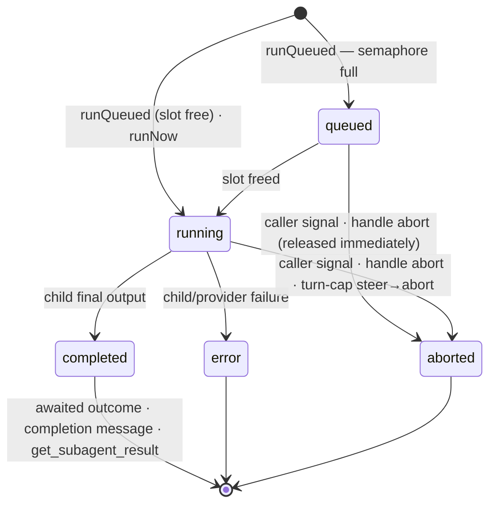

## 职责

`pi-delegation` 是**可移植的纯 pi 委派核心**：受控子节点的会话织物，
这些子节点由活动的父会话或独立资源拥有。一个带正交轴的创建原语（`createChild`）；
一个拥有运行循环（按父级 FIFO 定速、轮次上限、用量聚合）的句柄；作为存储布局的血缘；
一个内存中的运行注册表；以及生命周期事件。契约本身位于 barrel（`src/types.ts`，
每个类型都在原地文档化）；本 SPEC 记录语义、边界与决策日志。

会话父级路径支持带显式 `SessionOptions` 的隐藏、非交互子节点，
由[[module-pi-subagents]] 消费。已批准的资源扩展在 fresh 来源之外新增了一个资源所有
者与 `fork-captured` 历史，使用同一套组装与运行所有者。其他预先声明的组合仍然**被大
声拒绝**，抛出类型化的 `DelegationError`（见下面的范围与就绪规则）。

## 已批准的、资源拥有的扩展

持久化 DAG 消费者 [[module-pi-dag]] 在会话父级之外新增了一个独立的资源所有者。
资源子节点不需要虚假的父会话或活动父级查找。这为这条额外的所有权路径修订了仅限父级的
工作流假设与下面的决策 #9；既有的父级 API、默认值、收集、事件与级联保留其语义。
该扩展已实现；下面仅涉及父级的描述继续记录会话父级路径。

服务暴露 `registerResource` 与独立于 provider 的 `captureHistory`。
资源句柄拥有准备好的执行上下文、本地并发与精选工厂；它们暴露 `validateModels`、
`createChild`、`reopenChild` 与 `release`。子节点句柄暴露身份/记录、`runQueued`、
仅限活动调用的字面 `steer`、`abort` 与 `dispose`，而不是裸会话或第二运行循环。
`resolveParent` 对仅资源的构造是可选的。release 会了结待处理的组装/子节点/扩展，
且绝不处置外部借用的 runtime 或无关的父级子节点。

捕获接受一个受信任的只读 pi manager（带显式的条目/工具批次前切点），或一个已了结的、
带其保存边界的已存储资源子节点。它返回规范的分支 JSONL，外加身份、边界、摘要与大小。
消费者保留字节；核心做校验/捕获/fork，没有第二历史存储。`fork-captured`
增加不可变输入，而既有的活动源 fork/种子占位符仍然被拒绝。空切点是显式的，
工具不完整/损坏的捕获会失败，压缩与标签被保留，源历史绝不被改动。
资源对话记录查找是严格的，由捕获/重开共享，而不是任意文件导入器。

`reopenChild` 消费已保存的不可变诞生记录（不含其路径），加上已保存的声明式会话配置。
它校验 owner/scope/文件身份并保留诞生元数据，只解析出一条新的访问路径。
缺失的文件绝不创建替换会话。崩溃遗留的最后一个工具批次在 pi 重放之前会收到通用错误结
果；非尾部或格式错误的缺口会 fail closed，因为任何位置性修补都不安全。fork
组装会把真实的模型与 pi 钳制后的 thinking 持久化在子节点分支中；源元数据/全局默认值
保持完好。Pi 在重开时重载已选择的资源；保存的配置不是一份冻结的渲染后提示词。

`RunOutcome` 增加调用本地的 `stopReason` 与终态 `historyEntryId`。
已定稿消息的观察能在压缩（compaction）后存活；用量仍然是 pi 统计的增量。
资源提示词绕过命令与技能/模板展开。资源引导（steer）同步地只通过 pi
的队列瞄准活动调用；入队不是消费。取消覆盖预检/排队中的工作，并在准入另一次运行之前
清理残留队列。一切了结都留在既有的运行所有者内部。

提供 runtime 的 owner 保证其生命周期；基于注册表的保留复用不透明 provider 重放，
而不重载源扩展、也不从更晚的聊天重新同步。缺失的模型或不支持的、仅 runtime
可用的认证路径会显式失败，而不是被替代。两种保留对象都不是凭证快照或所有权租约。
回归覆盖必须包括源聊天处置之后更晚的子节点创建、父级行为不变，以及零 worker 保留。

### 资源实现决策与验证

- 资源对话记录使用 `<delegationRoot>/<scope>/.resources/<resourceId>/<pi-file>.jsonl`。
  scope/resource/会话各段都会被校验；捕获与重开共享一个经过身份检查的定位器，
  它会拒绝歧义的文件、符号链接、非常规文件与格式错误的 v3 历史。重开绝不使用调用方提
  供的路径，绝不伪造缺失的对话记录，并把已保存的诞生记录视为委派元数据的权威来源（这
  些元数据不在 pi 的头部中）。它只在构造会话之前修补活动尾部可安全重放的缺失结果。
- 注册会立刻保留身份，在返回之前准备上下文，且不创建会话。重复注册以 `resource-exists`
  失败。生效的模型引用必须精确解析（`model-unavailable`）；资源创建绝不回退到任意的
  SDK 模型。注册表输入只重放一次不透明的已配置/原生 provider 注册，不重跑源扩展。
  公开的认证来源元数据检测仅 runtime 可用的凭证与不可用的已存认证重放
  （`unsupported-auth`），而不提取密钥。这项静态检查无法担保不透明的 provider
  私有状态或未来的远程认证。
- 资源并发默认使用服务的父级上限（除非另有绑定，否则为 4），每个资源都有独立的 FIFO 槽位。
  资源本地工厂会增补服务的精选集合；既有的 `session.extensions` 选项与工具允许清单仍
  然适用。资源句柄与记录绝不出现在父级查找、收集、事件或处置级联中。子规范、
  模型引用与嵌套配置在准入可以 await 之前就被分离；记录及其 `info` 值是冻结的副本。
- release 同步关闭所有准入，在 await 任何拆除之前向每个子节点发信号，了结在途组装，发出并
  await 每个资源子节点的 `session_shutdown`，处置会话，然后移除注册/上下文/定速引用。
  并发的 release/处置共享它们既有的了结 promise；借用的 runtime 绝不被处置。
- 捕获序列化一个 v3 头部，以及恰好选定的祖先路径。`null` 是显式的空分支（`[]`，而不是
  `getBranch(null)`）。校验检查身份、形状、祖先关系、切点、SHA-256/UTF-8 长度、当前
  v3 的系统/用量/上下文编辑记录与压缩引用，包括 retain-none 压缩与标签条目。Pi
  公开的 `buildSessionContext` 提供压缩感知的重放；`scanReplayTools`
  提供工具闭包检查，以及宿主修补路径中不变的保守尾部修补候选。失败与中止的
  assistant 尝试不会凭空补出缺失的成功结果。捕获绝不修补。已存储的捕获直接读取已校验
  的字节，不调用 runtime 或可变的 SDK 文件打开。
- fork 使用一个内部私有的临时种子，配合原生的 `SessionManager.forkFrom`，在任一结果下都清理
  该种子。在改动提示词、工具或模型之前，子节点会追加上下文编辑来隐藏
  Anthropic/Claude 已签名或已脱敏的 thinking：这些签名绑定之前的前缀，
  不能移植到新的子节点。规范的已捕获字节与原始条目保持不变；未签名与其他 provider
  的推理仍然可见。真实的子节点模型与钳制后的 thinking 变更被追加，
  而不改动源历史或全局设置。捕获的字符串是消费者保留的不可变输入，不是核心历史存储。
  捕获会把分支物化；在这个有界扩展中不新增字节配额。准入上限策略仍然是后续工作。
- 资源提示词预检使用字面的扩展源输入；带守卫的引导同步调用公开的 `session.agent.steer`，传入
  未改动的用户消息。若某个提示词的运行在预检期间被取消，它会由每个子节点在自己的扩展
  之后加载的内部 `input` 处理器丢弃，因此用户消息永不被写入，也不会发出任何请求；
  对于剩下的时间窗口，取消会在 agent 启动时再次施加。Pi 1.2 从 `before_agent_start`
  起就把会话计为忙碌，并在该忙碌区间内运行 `preflightResult`，因此从中抛出（1.2
  之前的机制）会让子节点永远保持忙碌。队列在取消之前清空，并在另一次运行的了结/准入
  之前再次清空。资源句柄上的 `abort()` 会 await 该次调用的完整了结，
  包括排队中的工作。
- `RunOutcome.stopReason` 与最终文本是该次调用中最后一次已定稿的 assistant 观察，在重试/压缩
  中保持；取消意图不能覆写该停止证据。用量仍然是 pi 累积统计的增量。
  `historyEntryId` 是已了结的叶子，包括元数据/压缩条目，而不是成功完成的证明。

回归套件只使用本地合成 provider。它们覆盖父级兼容性与已捕获的父级 fork；零
worker/借用/注册表/原生 provider 的保留；严格的已存储捕获/重开（含崩溃尾部修补与非尾
部拒绝）；规范切点、当前 v3 条目、摘要/闭包/压缩校验；独立于源的扇出（带 provider
绑定的 thinking 脱敏）；分离的准入输入；资源本地工厂与 FIFO 隔离；
字面引导与过期队列清理；排队/预检取消；待处理组装/关闭的 release 屏障；
以及收缩压缩之后的已定稿结果。

## Public surface（公开接口，barrel，`index.ts`）

- `createDelegationService(bindings)`——服务（`DelegationService`）：`createChild` /
  `setMaxConcurrentPerParent` / `findChild` / `childrenOf` / `onLifecycle` /
  `disposeChildrenOf`，外加 `registerResource` / `captureHistory`。资源、
  诞生与已捕获历史的契约类型从实际的包 barrel 导出。`scanReplayTools`
  是捕获与宿主对话记录修补共享的纯重放扫描器；修补策略与合成工具结果仍然由宿主拥有。
- `DelegationBindings`——一切宿主专属的东西：`resolveParent`（对仅资源的服务可选；父级创建
  需要它以及一个活动结果；返回 `ParentContext`——
  `Pick<ExtensionContext, "cwd" | "model" | "thinkingLevel">`，外加可选的
  `isProjectTrusted`、`modelRuntime` 与 `modelRegistry` 字段。`isProjectTrusted`
  是子节点设置管理器所收到的 pi 级项目信任（在创建时询问一次，并在下面的重新校验时再
  询问一次）：信任是子节点从父级派生的上下文的一部分，因此子节点加载的项目绝不比其父
  级更多——纯 pi 的 `ctx` 携带该会话自身的信任，ThinkRail 回答其父级已加载的信任
  AND 当前的 `Project.piResourceTrust`；缺省 → 受信任，即 pi 自己
  `SettingsManager` 的默认值。资源上下文（`ResourceContextInput`）
  接受同一个可选字段。父级自己保留的 `modelRuntime` 优先于一切后备：
  若嵌入方的每个会话都保留其创建时的 runtime 世代（ThinkRail），它必须给子节点*父级*
  的世代，否则一个在断连后仍靠 Central-only 模型存活的父级会委派到一个缺少其
  provider 的 runtime（PR #303 复查后续）。`modelRegistry` 是公开的纯 pi 兼容路径：
  当父级与服务都未绑定 runtime 时，核心在每次解析子节点之前把其不透明的扩展
  provider 注册镜像到自建的 runtime，包括移除已经消失的注册。ThinkRail 投影 manager
  的活动会话，含该条目的世代 runtime；纯 pi 传入扩展自己的 `ctx`，包括其注册表），
  `delegationRoot`、`scope`、`modelRuntime`（一个 `ModelRuntime` 值**或一个活动
  provider** `() => ModelRuntime | Promise<ModelRuntime>`，**按每次 `createChild`**
  解析：嵌入方的 runtime 可能是世代化的——ThinkRail 在 Central 连接/断开时替换
  runtime 世代——而在服务创建时捕获的值会把之后每个子节点钉在第一个世代上，
  即使新的父级聊天已经前进（PR #303 复查发现）；缺省 → 服务**按父级血缘**自建一个
  runtime 并缓存它，直到 `disposeChildrenOf(parent)`——一个服务可能解析由不同注册表
  支撑的父级，因此一个可变后备绝不能在这些父级之间同步 provider 状态）、
  `maxConcurrentPerParent`、`childBaseExtensionFactories`（**每个**子节点都会加载的
  仅钩子集合）与 `childExtensionFactories`（子节点**可以**加载的精选集合）
  ——两者都是决策 #25，两者都是 pi 的 `InlineExtension`，因此嵌入方可以传裸工厂或
  `{ name, factory }`，并把名字保留在 pi 诊断中——以及
  `buildChildSettings`（决策 #31）。
- 存储辅助：`defaultDelegationRoot` / `delegationSessionDir` / `deriveChildSessionFile`
  （重启后读取对话记录）/ `DEFAULT_SCOPE`。
- 契约类型本身（含 `DelegationError`/`DelegationErrorCode`）——在 `src/types.ts` 中枚举并
  原地文档化，此处不再复述。

## 边界

- **允许的依赖：** pi SDK（`@earendil-works/pi-coding-agent`、`@earendil-works/pi-ai`）作为
  **peerDependencies**——由加载它的 runtime 提供；`node:*`。
- **禁止：** 任何 `@thinkrail/*` 包（本包必须在 vanilla pi 下可用）；
  `@earendil-works/pi-tui`（按设计无头——渲染是嵌入方的事）；导入另一个工作区包的内
  部。
- `DelegationRunDetails` **在此撰写，并镜像进 `@thinkrail/contracts`**（绝不从它导入，也绝不
  由它再导出）——即 `pi-todos` 的 DTO 姿态。
- 消费者**只经由 barrel** 导入；`src/` 是内部。
- 裸的子节点 `AgentSession` 绝不穿过 barrel——`ChildHandle` 是唯一的控制路径。

## 模式 = 轴组合

| 模式 | 规范 | 由谁驱动 |
|---|---|---|
| **子代理** | `{origin: fresh, visibility: hidden, interactive: false, info: {createdBy: "tool:Agent", roleName, roleSource}, session: from definition}` | `runQueued(task)`——被 await（前台）或不 await（后台） |
| 交互式子会话 | `{origin: fresh \| fork, visibility: listed, interactive: true, info: {createdBy: "user"}}` | 用户，经由 manager——绝不是运行方法 |
| 分支 | `{origin: fork(current, entryId), visibility: listed, interactive: true, info: {createdBy: "user"}}`（无 `session`） | 用户 |
| 工作流步骤 | `{interactive: false, info: {createdBy: "workflow:<name>"}}` | 由引擎调用 `runQueued`/`runNow` |
| 工作流人工门禁 | `{interactive: true, visibility: listed, info: {createdBy: "workflow:<name>"}}`——引擎*创建*、人类*驱动*：之所以可表达，是因为行为与来源是分开的字段 | 用户；引擎 await 其结论 |

## 语义

### 交互式与非交互式（核心强制执行的唯一行为分野）

| | `interactive: false` | `interactive: true` |
|---|---|---|
| 谁发起提示 | spawner（工具调用 / 引擎） | 人类（输入框） |
| WS 提示输入 | 拒绝 | 接受（要求 `listed`；`hidden + interactive` 会拒绝） |
| 信号量 | `runQueued` 等一个槽位；`runNow` 绕过 | 不适用——运行方法会拒绝 |
| `RunOptions.maxTurns` | 生效（上限 → steer → abort） | 不适用 |
| 完成 | 终态事件 + `finalText`；投递（工具结果 / 完成消息）由消费者决定 | 没有 `finalText`——子会话落地时用"conclude"动作 |

### 运行生命周期

每次 `runQueued` 运行都会经过 `queued`——即使槽位空闲也会发出 `run-queued`，
并立刻跟随 `running`（统一的事件流对消费者来说比有条件的第一状态更简单；当 `runNow`
落地时，图中直接进入 `running` 仍然是它的语义）。进入 `queued` 会初始化匹配的
`RunSnapshot.status` 与 `RunSnapshot.details.status`；迁移到 `running` 会在发出
`run-started` 之前一起更新这两个字段与该运行的 `onUpdate` 回调，因此消费者绝不会观察
到彼此矛盾的在途状态投影。

### 等待与控制

| 机制 | 行为 |
|---|---|
| 前台 | `await child.runQueued(task)`。pi 会并发执行一个批次的工具调用（已验证：`pi-agent-core` 的 `executeToolCallsParallel`），因此 N 个 `Agent` 调用 = N 个子节点在途——不需要 `tasks[]`/链式 DSL。 |
| 每次运行的结果 | 一个 `RunOutcome` 的 `finalText`、`stopReason` 与 `details.usage` 只属于**那一次运行**：运行在 `prompt()` 之前捕获会话统计基线，观察已定稿 assistant `message_end` 事件的文本/停止证据（绝不用收缩的 message 数组下标），并报告相对于基线的用量/成本/token **增量**——绝不是子会话的累积总量。否则一个复用子节点顺序执行任务时，会在预检失败后返回上一次运行的文本、并重复计算用量（PR #302 复查发现）。按设计，`contextTokens` 保持为某一时点的快照。 |
| 并发 | **每个父会话**一个信号量，默认 4；FIFO。为什么：模型决定要发出多少次 spawn——每个子节点都是一个完整的 LLM 会话，因此无界 spawn 会成倍放大 token 支出、provider 429 压力，以及唯一共享事件循环上的负载（没有崩溃隔离）。这是资源治理，而不是正确性。上限是**活的**：`setMaxConcurrentPerParent(n)` 会调整每个既存父级信号量的尺寸，以及之后父级的默认值——增长会立刻按 FIFO 准入排队的运行，收缩绝不停止正在运行的子节点，只在新上限之下准入。资源信号量保持其注册时的槽位。嵌入方拥有该策略（ThinkRail：全局设置 + 工作区覆写）。跨父级的宿主级上限：后续工作。 |
| 后台 | 不要 await 该 promise。完成 → `run-terminal` 事件；子代理工具层还会向父级注入一条 `subagent-completion` 自定义消息。 |
| 结果收集 | 通过 `findChild(id)` 取得注册表快照：终态 → 最终输出 + 详情，标记为 `collected`；运行中 → 状态快照（不是错误）；未知 id → 错误，指出重启丢失的情形 + 推导出的对话记录路径。 |
| join / wait-all | **非核心。** 引擎在 `run-terminal` 事件 / 运行 promise 之上做控制流：join = 对运行结果做 `Promise.all`；扇出 = 共享同一依赖的 spawn（信号量给它们定速）；fail-fast = 跨兄弟 `RunOptions.signal` 共享一个 `AbortController`。 |
| 轮次上限 | `RunOptions.maxTurns`：到达上限时，先 `steer()` 一条收尾指令，然后 `abort()`。没有墙钟超时（provider 重试是 pi 的事）。 |
| 中止 / 处置 | `RunOptions` 中的 `signal`（工具中止、引擎 fail-fast）与 `ChildHandle.abort()` 都通过一个运行作用域信号取消活动的运行。句柄路径必须取消仍然**排队中**的运行，而不只是对它空闲的 pi 会话调用 `abort()`：排队的取消立刻了结，而最终的槽位授予被直接交还，也不会启动任何 provider 工作（PR #302 复查发现，有回归测试钉住）。运行中的取消会中止 pi 会话。`ChildHandle.dispose()` 先把子节点标记为已处置，通过同一个信号取消，并 await 运行的终态了结，然后才处置 pi 会话并移除子节点；因此排队的运行不会卡在兄弟节点之后，也不会在 `child-disposed` 之后再发出终态生命周期工作（PR #302 复查后续发现，有回归测试钉住）。每个子节点拥有一个共享的拆除 promise：并发的句柄处置与父级处置都会 await 它，因此 `disposed` 意味着准入已关闭，而不是拆除已经完成。父级处置 → `disposeChildrenOf` 级联，其中包含仍然注册到该父级的、已在处置中的子节点，然后**在 await 任何共享拆除之前，把每个已捕获的子节点标记为已处置，并同步向每个活动运行发信号**；只要子节点工作仍在了结，它就不能返回（第二次 PR #302 复查后续发现，有回归测试钉住）。中止一个正在运行的子节点会释放其信号量槽位，而未标记或未取消的排队兄弟节点否则可能在级联期间发出 provider 工作或一直挂起。父级轮次中途中止只通过其信号杀掉被 await（前台）的运行；脱离的运行能在轮次中止后存活。 |
| 重启 | 前台的悬空 toolCalls → 由嵌入方通用的对话记录修补来治愈（ThinkRail：`repairDanglingToolCalls`）。注册表在内存中：脱离的运行会丢失（已接受）；对话记录留在磁盘上，仍可打开。 |

父级 id 拥有可替换的内存生命周期。`disposeChildrenOf(parent)` 同步轮换该生命周期，
脱开其子节点集合、信号量与后备 runtime，向每个已准入子节点发信号，并 await
那些子节点以及在被退役生命周期中开始的子节点准备。之后具有同一 id
的父级会立刻获得新生命周期；来自已退役生命周期的清理不能移除子节点，
也不能把它们准入到替换者中。一次准备在组装之后重新检查其捕获的生命周期，
并在过期时先处置未注册的会话再拒绝。

`ChildHandle.abort(reason?)` 同步安装取消意图，包括针对排队中的工作；当 Pi
正在了结活动的 provider/工具运行时，它的 promise 可能保持待处理。
承认意图而非了结的调用方可以脱离该 promise，但必须挂一个拒绝处理器，
并继续把生命周期快照当作终态权威。

### 存储与血缘

- **隐藏子节点持久化在嵌入方绑定的委派根下，绝不是 pi 的默认会话根：**
  `<delegationRoot>/<scope>/<parentSessionId>/<child>.jsonl`，经由
  `SessionManager.create(cwd, sessionDir)`——已验证：pi 在
  `create`/`open`/`list`/`forkFrom` 上接受自定义 `sessionDir`（最后一个覆盖未来的
  `fork` 轴）。ThinkRail 绑定 `~/.thinkrail/delegation`，`scope = workspaceId`；纯
  pi 默认为 `<piAgentDir>/delegation`，`scope = "default"`。按构造即隐藏：
  会话列表只扫描默认根。
- **血缘 = 存储布局。** 目录结构*就是*父级边；对话记录路径由
  `(scope, parentSessionId, childSessionId)` 推导，没有索引文件。已持久化的
  `SpawnRecord` 索引会在 `listed` 可见性落地时成真（类型现在就有，文件还没有）。
- **核心只存储父级边——一棵树，绝不是 DAG。** 工作流的每个步骤都以
  `parent = the run's root session` 被 spawn（兄弟）；DAG 的数据流边是引擎自己的记录。
  后果：整体运行取消 = 对根的子节点执行既有的级联（无图遍历）；join 是引擎的控制流，
  不是一个会话。
- **保留是嵌入方的责任：** ThinkRail 把子节点生命周期系于**工作区**（归档即删除；关闭标签页
  什么都不删——机制：[[submodule-server-agent]]）。纯 pi：没有 GC。
  任何地方都没有按父级的 GC。
- `listed` 子节点（未来）搭乘一切既有的东西——manager 注册 → 标签页、WS 流式、水合、重启
  修补；线上协议的 `SessionSummary` 到那时才增加可选的血缘字段，而不是现在。

## 子节点组装（核心拥有、消费者永不可见的部分）

子节点的资源加载器**默认狭窄**：不发现扩展、不加载提示词模板、不加载主题；
上下文文件、技能与嵌入方的精选扩展集合（`extensions: true`——决策 #25）都是显式的
`SessionOptions` 选项，只有嵌入方的仅钩子基础集合无条件加载（同一决策）；
`systemPrompt` 映射到 `systemPromptOverride`。模型/thinking 默认为活动父级的当前值；
`cwd` 是父级的。runtime 优先级为父级 `modelRuntime` → 服务 `modelRuntime`
→ 缓存的自建 runtime。自建路径按父级血缘缓存一个独立的 runtime 与镜像注册集合；
`disposeChildrenOf(parent)` 会随血缘丢弃该缓存条目。它在每次 spawn
之前镜像父级公开的 `modelRegistry` 注册：每个先前镜像的 id 都会先被注销，
然后才重放当前的原生 provider 与不透明的已配置 provider 配置。必须重建而不是合并，
因为 pi 的 provider 重新注册会保留被省略的字段；若不注销，同 id 的替换可能保留诸如
secret 头这样的过期配置。这在不读取任何一方的情况下保留了扩展提供的 provider
行为与配置内含的认证；它无法重现只存在于原始 runtime 内部的凭证或可变状态，
这正是精确 runtime 注入仍然是更强的嵌入方契约的原因。存储：见上面的血缘小节。

## 扩展点（恰好三个，外加一个接缝）

1. **LLM 工具**（现在是 `Agent` 工具）——服务之上的扩展工厂。为 LLM 编排的工作流服务，无需
   任何进一步机制。
2. **服务 API**（barrel）——线上协议处理器（分支、子会话）与编程式工作流直接调用它。
3. **生命周期事件**——声明式工作流引擎可以订阅；每个事件携带 `{sessionId, parentSessionId}`，
   使引擎能构建自己的步骤图，而无需核心存储 DAG。

外加**工作区接缝**（`WorkspaceProvider`）：把子节点隔离（git worktree、tmpdir、
容器）作为可插拔策略。ThinkRail 天然的 provider 已经存在——projects/workspaces
特性拥有 `git worktree` 的创建；合并回来的语义位于 provider 的
`dispose`（`resultAddendum` 告诉父级工作落在哪里），绝不在核心里。（该模式由
gotgenes 的 ADR-0002 接缝 + 配套的 worktrees 包验证。）

## 可移植性与嵌入（用户敲定，2026-08）

这一层必须**在 vanilla pi 下可用**——不依赖 ThinkRail。`pi-delegation`
本身是一个库；vanilla pi 实际加载的扩展是它的第一个消费者 [[module-pi-subagents]]。
SDK 是 `peerDependency`（经实地验证是社区的进程内模式——决策 #17）；peer
依赖不受仓库精确钉住规则的约束，而且在这里对 SDK 做值导入是安全的，
因为本包按构造位于服务端，永远不会到达 `contracts`/`web`（线上协议类型是镜像的——决
策 #20）。

嵌入方通过 `createDelegationService(bindings)` 构造服务并交给消费者——ThinkRail
保留该句柄用于 manager 的处置级联与未来的线上协议处理器，并把它传给 `pi-subagents`
工厂；在 vanilla pi 下，`pi-subagents` 扩展用默认值构造它。一切宿主专属的东西都通过
唯一的 `DelegationBindings` 袋子进入（在 `src/types.ts` 中类型化 + 文档化）；
**除使用会话父级创建时的活动父级查找外，每个字段都有纯 pi
的默认值**——`resolveParent` 对仅资源的服务是可选的；嵌入方拥有会话父级查找
（ThinkRail：manager；纯 pi：消费扩展自己的 `ctx`）。

**纯 pi 底线（用户敲定）：** 消费扩展在 vanilla pi 下、使用 pi 的**默认工具渲染**即
可正确加载并运行——没有 pi-tui 组件（丰富的实时卡片是网页渲染器的职责）。按需由
`bun run smoke:subagents` 验证（描述见 [[module-pi-subagents]]）。npm
发布仍然保持可能；不是目标。

## 范围与就绪规则（用户敲定）

**已实现的核心服务子代理与上面那个已批准的资源拥有扩展。** 其他未来模式在范围之外，
其 UX 未钉住——但核心必须就绪：**契约携带完整的轴空间；实现保持最小**。
未被演练的组合（`listed`、活动源 `fork`、`seeded`、`interactive: true`、`runNow`、
`session` 缺失、`workspace` provider）会以类型化错误**大声拒绝**——接缝是真的，
死代码不是。未来模式的第一个消费者只须*填上*自己的组合，绝不重塑契约。

契约曾在纸上针对每个未来模式核对过（2026-08，实现之后）：*子会话*——
`{origin: fresh|fork, listed, interactive}` 可以表达；交互式子节点上的运行方法会拒绝
（`invalid-combination`）。*分支*——`{origin: fork(entryId), listed, interactive}`
不带 `session` 选项即可表达；pi 的 `forkFrom` 接受自定义 `sessionDir`（已验证）。
*工作流*——三种风格都映射到三个扩展点，只需要 `runQueued` + `signal` + 处置级联。
有一条保留：`WorkspaceProvider` 的调用时序（`prepare` 要命名子节点 id，而该 id
只在创建之后才存在）由其第一个消费者（ThinkRail 的 worktree provider）钉住。
子会话向父级回报（当子会话落地时）是 pi 原生的（`sendMessage`/`followUp`）
——除血缘之外无需核心提供任何东西。

## 用户取消

`ChildHandle.abort(reason?: string)` 把其可选的纯字符串原因记录到活动运行的
`DelegationRunDetails.abortReason`，并在快照、结果与终态事件中保留。
第一个被接受的取消获胜，包括不带原因的那次；调用方信号、处置与轮次上限参与该排序，
但不添加原因。终态运行保持不变，每次新运行都会重置取消闩锁与原因两者。原因是元数据，
不是生命周期状态。

子节点创建在异步的会话/扩展准备之后、在注册句柄之前重新校验父级上下文：
父级必须仍然可解析，且其 `isProjectTrusted` 必须仍然给出子节点设置所捕获的答案。
如果嵌入方在准备期间关闭了该父级、或其信任发生了变化，未注册的子节点会被处置，
创建以 `unknown-parent` 失败——子节点为之准备的上下文已不复存在。
这防止在途的诞生逃出父级已捕获的拆除清单，或逃出一次吊销已捕获的子节点清单，
同时不引入第二个待处理子节点注册表。

宿主对显式用户取消使用 `"user"`；[[module-pi-subagents]] 拥有其完成策略。不涉及 UI
依赖或第二个注册表。排队的取消立刻了结，交还任何最终的槽位授予，且不启动 provider
工作；运行中的取消使用既有的运行作用域信号。非用户路径保持其行为。

## 决策日志（契约如何成形）

1. **两段式接口**（`createChild` → `runQueued`/`runNow`）优于一个大而全的 `spawnSession`，也
   优于按模式分别提供构造器（设计选项轮）：创建与运行是不同的时刻；
   运行循环（信号量、用量聚合、轮次上限）只被拥有**一次**，而不是每个消费者一份；
   多数状态因构造成立而合法。按模式的语法糖（例如 `runSubagent`）
   以后可以出现在消费者层——绝不作为核心契约。
2. **`driver: "tool" | "user" | "orchestrator"` 枚举被拒**：它把行为与消费者身份混为一谈，是
   封闭集合（新消费者 = 重塑契约），也无法表达人工门禁的混合形态（引擎创建、
   人类驱动）。取代它的是 `interactive`（行为）+ `ChildInfo.createdBy`（开放来源）。
3. **`SessionOptions` 镜像 pi 的 spawn 签名**（用户决策）——会话塑形子集使用 pi 的名字/语义；
   基础设施子集（modelRuntime、sessionManager、settingsManager、resourceLoader、
   customTools）被防火墙隔开——暴露它会让消费者绕过存储/血缘/信任。
4. **`maxTurns` 放在 `RunOptions`**，而不是 `SessionOptions`（镜像纯粹性——pi 没有这个选项），
   也不放在创建时（按运行：一条链会以不同上限复用同一个子节点）。
5. **定速 = 两个显式方法**（用户轮；取代一个 `pacing` 选项及其短暂的删除）：一个会静默停在
   队列上的 `run()` 是隐藏策略——调用点必须说明它要哪一种。`runNow`
   在还没有消费者时大声拒绝，与就绪规则一致。
6. **`visibility` 必需，无默认值**（用户轮）——同样的调用点透明规则。它保持为*核心*轴，因为
   它的后果（存储根、manager 注册）是只有核心才能执行的创建期动作，而且它无法从
   `interactive` 推导出来。
7. **`ChildInfo`** 归拢描述性元数据（用户轮）——"元数据、绝不是行为"的边界是结构性的；角色
   标签**内联**为 `roleName`/`roleSource`（不为两个字符串设嵌套对象；镜像
   `DelegationRunDetails`）；`roleSource` 是开放字符串（builtin/personal/project
   的分类法是子代理层的词汇）。
8. **一个 id，急切创建**：一次运行*就是*一个子会话；子节点从 `createChild` 起就存在（排队 =
   只有它的第一个提示词在等待），因此该 id 从诞生起对卡片/对话记录就是稳定的。
   没有单独的运行 UUID。
9. **`parent` 是唯一的身份输入**——`scope`/`cwd`/模型默认值从活动父级派生；不一致的三元组
   不可表示；父级必须是活动的（`unknown-parent`）。
10. **运行方法对运行失败以 resolve 返回**（`error`/`aborted` 是带详情的值）；类型化的
    `DelegationError` 拒绝只用于契约误用。
11. **每个子节点同一时间只有一次运行**；允许顺序运行；注册表保留最新快照——多次运行的历史是
    调用方自己的账。（若将来某个舰队视图需要历史，再重新考虑。）
12. **`background` 从核心中删除**——脱离 = 不 await 该 promise；无论如何注册表都会跟踪该运行。
13. **`toolCallId` 被移除**——运行↔toolCall 的配对是工具层自己的账。
14. **`SubagentRunDetails` → `DelegationRunDetails`**——线上协议类型是与模式无关的。
15. **`findChild` / `childrenOf`**（改名自 `getChild`/`listChildren`）——两种查找以不同的 id
    为键；名字现在体现了键。
16. **裸 `AgentSession` 绝不暴露**——句柄是唯一的控制路径；对排队子节点做带外提示在结构上
    不可能。（`resolveParent` 绑定把*嵌入方的*活动父级交给核心——这是嵌入方的管道，
    不是消费者接口。）
17. **可移植核心——这个包就是交付物**（2026-08，PR #261 复查轮）：用户敲定了"这一层要**在没有
    ThinkRail 的情况下、在纯 pi 中**工作"的要求。实地调研（已核对源码）：pi 示例
    spawn `pi --mode json -p --no-session` 子进程；nicobailon spawn 子进程（前台
    +脱离的 runner）；**gotgenes 与 tintinweb 通过 `createAgentSession`、以 pi SDK
    作为 peerDependency 在进程内运行子节点**——证明进程内的纯 pi
    子节点是已被解决的模式。因此核心从 `packages/server` 的一个子模块迁移到
    `packages/pi-delegation`；ThinkRail 只是一个嵌入方。
18. **宿主注入的 spawn 接缝被拒**（解决了 PR #261 的边界提案——以强化形式采纳）：宿主注入的
    `SpawnBackend` 会要求一个第二的、包内的纯 pi 运行循环来满足 #17，重复决策 #1
    刻意只拥有一次的循环。没有任何参考实现注入 spawner——四者都把 spawn
    留在扩展内部，并把各自的接缝朝向*外部*（生命周期事件、provider、RPC）。
    提案的边界那一半被采纳——并强化：整个核心都变得可移植，不只是工具层。
19. **两个包**——`pi-delegation`（框架）+ `pi-subagents`（第一个消费者）："框架就是交付物"
    由构造强制；未来的消费者（工作流引擎、子会话/分支线上协议处理器）
    取用委派而不带子代理。（gotgenes 把核心留在它的 subagents 包内；
    我们拆分是因为未来的消费者是宿主特性——一个宿主为了得到委派而导入
    "subagents"会错称该依赖。）
20. **`DelegationRunDetails` 镜像进 `contracts`、绝不被导入**——`pi-todos` 的 DTO 姿态保持
    `web → contracts` 的唯一方向完好，并使本包不依赖宿主。（已否决：
    在包内撰写该类型并通过 `contracts` 再导出——`contracts` 不导入任何扩展包。）
21. **纯 pi 底线：在默认渲染下加载 + 可用**（用户敲定）——没有 pi-tui 组件；丰富的实时卡片
    在网页侧发布。
22. **`collectResult()` 加入 `ChildHandle`**（实现轮）：`collected` 标志需要一个维护者，而一个
    有副作用的 `snapshot` getter 是唯一的替代——`snapshot` 保持纯读取；
    收集是显式的动作。
23. **`resolveParent` 返回投影，而不是 `AgentSession`**（用户轮，子代理实现）：pi 的扩展 API
    只暴露 `ExtensionContext` 投影——扩展永远无法取回自己的 `AgentSession`，
    因此在纯 pi 中裸会话绑定无法满足。核心只从父级读取
    `cwd`/`model`/`thinkingLevel`（+存活状态），因此
    `ParentContext = Pick<ExtensionContext, …>`（类型复用而不是新类型——用户注记）
    覆盖了两种世界中被验证过的一切用法，并在结构上防止核心驱动父级。
24. **`RunSnapshot.errorMessage`**（复查轮 2）：终态快照保留出错运行的原因——没有它，之后通过
    `get_subagent_result` 收集的脱离错误携带零诊断信息（完成消息里有，收集路径没有）。
25. **子节点扩展：一个精选的、由嵌入方绑定的集合——绝不是继承，绝不是磁盘发现**（用户轮）。
    `SessionOptions.extensions: true` 恰好加载
    `DelegationBindings.childExtensionFactories`（pi 的加载器即使在 `noExtensions`
    下也会加载注入的工厂——已验证）；`tools` 允许清单门控该集合中哪些工具可调用；
    加载了任何工厂的子节点被绑定为 `mode: "print"`（无头—— `ctx.hasUI` 为 false，
    对话框被跳过）。唯一无条件的集合是
    `DelegationBindings.childBaseExtensionFactories`：每个子节点——普通的或资源的、
    选择加入与否——都会在精选集合之前加载它。它携带嵌入方在每次子节点请求时都需要的
    无工具基础设施钩子（ThinkRail：超大图像守卫，它是决策 #31 的原始图像设置所必需的
    ——PR #657 复查：自定义 agent 默认不带扩展，因此一个选择加入的守卫会让它们失去
    保护）。在那里注册的工具会到达从未选择加入的子节点，因此保持该集合无工具是嵌入方
    的契约；核心不做监管。字面的"继承父级的扩展"被拒：
    交互式工具（ask_user_question）会挂起隐藏的非交互子节点，而无差别加载会按子节点
    成倍放大重量级扩展（gotgenes 有记录的 V8 堆事故类别）。**子会话仍然搭乘委派核心**
    ——一个子会话就是
    `createChild({visibility: "listed", interactive: true, origin: fresh | fork})`，
    由核心拥有创建、血缘、注册表与生命周期事件，与任何子节点完全一样；
    精选集合机制*不*覆盖的是 listed 子节点的*资源组装*：当 listed 轴落地时，
    核心会取得一个嵌入方接缝，使 listed 子节点的加载器由宿主的常规会话路径构建
    （ThinkRail：`createSession` 自己的加载器——完整的打包集合，含 visualize +
    ask_user_question、技能、准入），并且子节点在宿主的 manager 中注册（标签页、WS
    流式、水合）。
26. **纯 pi 后备使用公开的 provider 重放；嵌入方使用精确的 runtime 复用。** Pi 的扩展上下文
    暴露 `modelRegistry`，但不暴露其背后的 `ModelRuntime`，而 `createAgentSession`
    要求一个 runtime。因此自建的子节点 runtime 在每次 spawn 之前同步注册表公开的
    `getRegisteredProviderIds` / `getRegisteredNativeProvider` /
    `getRegisteredProviderConfig` 值，并注销过期的镜像。runtime 与镜像集合以父级血缘
    为键，并由 `disposeChildrenOf` 丢弃；否则同步第二个父级可能移除或替换仍被第一个
    父级子节点使用的 provider。这是不透明重放，不是 provider 解读、
    私有字段访问或扩展重跑。它让独立子节点与注册 provider 的扩展兼容，同时为仅
    runtime 可用的凭证与状态保留更强的父级 runtime 路径。
27. **资源所有权不是合成的会话父级。** 一个准备好的资源上下文与本地信号量喂给既有的子节点
    组装/运行所有者；不引入第二的会话 runtime 循环、子节点注册表 API、
    血缘索引或持久负载存储。父级行为保持独立。这扩展了决策 #9，而不是削弱父级存活要
    求。
28. **规范化捕获独立于 provider 且不可变。** 一个受信任的只读 manager，或一份严格定位的资源
    对话记录，提供显式的切点。重放安全性使用 pi 的上下文构造与共享的通用扫描器校验。
    fork 准入会再次校验；捕获之后源的可用性无关紧要。活动源 fork/种子占位符仍然被拒
    绝。
29. **忠实重开使用调用方的诞生权威，而不是虚构的对话记录元数据。** scope、资源/文件身份与
    受支持的塑形都会被校验；不可变的诞生元数据除其新解析出的访问路径外原样存续。
    已选择的资源通过正常的 pi 组装重载，而不是一份持久化的渲染后提示词。
30. **资源控制是字面的且以调用为作用域。** 引导绝不启动轮次，队列在后继准入之前清空，取消
    覆盖从预检直到终态了结的全过程。已定稿的消息事件提供停止/文本证据；pi
    持久化条目的统计提供用量增量。

31. **子节点设置是嵌入方绑定的基础设施钩子，绝不是 `SessionOptions` 的镜像**（issue #604）。
    每个子节点的设置管理器在绑定时是 `buildChildSettings(cwd, projectTrusted)`，
    否则是 `SettingsManager.create(cwd, undefined, { projectTrusted })`，其中
    `projectTrusted` 是父级（或资源）上下文的 `isProjectTrusted`，
    因此嵌入方的子节点运行在其自身会话所用的设置与信任之上。ThinkRail 绑定
    `buildSessionSettings`，正是它的原始图像覆写让子节点的 `read`
    能在编译后二进制中投递图像（理由：[[submodule-server-agent]]）；若不绑定，
    那里每次子节点对图像的 `read` 都会返回 pi 的 `[Image omitted…]` 说明。
    该钩子位于 `DelegationBindings` 上、与各工厂集合并列，保持决策 #3 的防火墙：
    设置管理器仍然是没有任何消费者按子节点塑形的基础设施。
