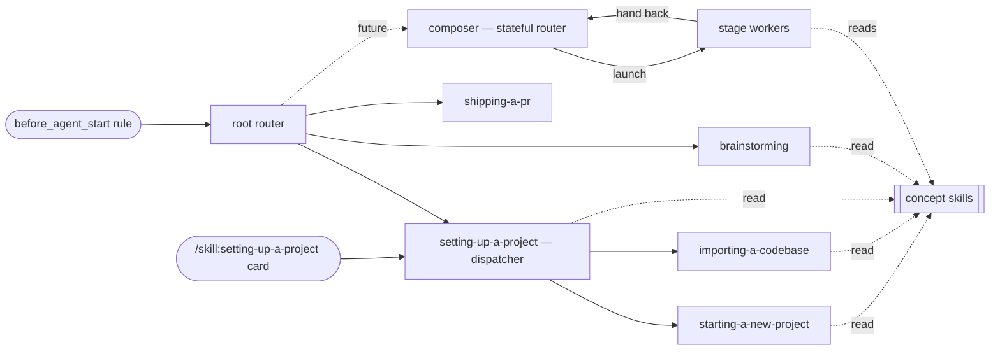

## 职责

这个目录是**工作流技能族**：一批把 agent 应当*如何完成一件工作*编纂下来的流程类技能。这份规范是这一族
的**元层** —— 概念模型、三种技能角色，以及治理此处每个工作流技能的元规则。它是权威的*为什么*；
`writing-workflow-skills` 技能承载可执行的编写清单，并指回这里（它的“（规则 N）”引用就是下面的元规则）。
打包、交付与包边界住在父级 [[module-thinkrail-workflow]]。

出处：设计于（此后已退役的）workflow-system 任务规范，调研参考了 obra/superpowers、gsd-build/gsd-2、
Anthropic 的技能编写指引，以及 JetBrains/thinkrail-v1 —— 后者的工作流是未来可能出现的复杂工作流的一个
*示例*，而不是模板。

## 概念模型

- **工作流** —— 一种可重复的完成一件工作的方式，被编纂为一个或多个技能。
- **工作流技能** —— 一个技能 = 一个*可从外部触及*的工作流*或一个共享概念*；简短、祈使、聚焦于工作流。
- **兄弟文档** —— 技能 `SKILL.md` 旁边的文件，承载一个内部工作流节点（一个分支、阶段或共享尾部）或
  参考细节；在交接到它的那个确切步骤里被点名，按需读取，绝不单独被发现（规则 1 与 3）。
- **概念** —— 一个主题的可复用规则、惯例或心智模型 —— 流程类技能所立足的共同地基，当不止一个技能需要
  它时，被编纂成它自己的技能。
- **交接** —— 工作流技能末尾那处显式的、按名字的转移，或者一个声明过的终止状态。
- **门禁** —— 一个硬性的纪律点（例如“设计获批之前不做实现”），配有反合理化说明，而不是软性建议。
- **制品** —— **规范树**（持久记录：决策、契约、局限、原则 —— 代码无法揭示的一切）与**临时文档**
  （为一件工作搭的脚手架：一份任务规范，和/或工作流声明的工作文件），由规则 8–9 治理。这个划分是
  *生命周期*的，不是文件类型的 —— 任务规范活着的时候在图内（规范工具），但它仍是一份临时文档。临时
  文档还有一个指定的*家*：工作区里被 gitignore 的 `.thinkrail/context/`（按工作树由宿主播种、零 git
  足迹，但仍会被规范工具扫描），因此它们对 agent 是活的，却绝不会到达已提交的树 —— 持久内容就地落进
  规范树（规则 8）。

## 技能角色与交接契约

每个工作流技能恰好扮演**三种角色**中的一种；比这更丰富的东西都是由它们搭出来的*模式*。

| 角色 | 正文包含 | 结尾方式 |
|---|---|---|
| **路由器** | 只有分类规则 + 交接 | 点名接下来运行什么 |
| **工作者** | 一个工作流的步骤 —— 在它的正文与它的兄弟文档里 | 一次交接 —— 固定的后继、回到它的调用方，或一个终止状态（声明在流程结束的那份文档里，规则 6） |
| **概念** | 一个主题的可复用规则、惯例或心智模型 —— 没有步骤、没有路由 | 什么都没有 —— 完全没有结尾一节；控制权直接回到它的读者手里 |

**根路由器**是新出现的、符合工作流条件的工作的唯一入口；一条始终启用的规则点名那些类别并把它们指向
它。已经被路由过的工作恢复它当前的工作流，而不是重新进入路由器。分支技能可以路由得更远（分形路由）。
**概念**不是流程的构件 —— 路由器与工作者在需要它的那个确切步骤里点名它，而它绝不是一条路由：路由器
分类的是*工作*，而概念不是工作。

**模式**（词汇，不是角色 —— 尚无实例；用于复杂工作）：

- **编排器（Composer）** —— 一个*有状态的路由器*：与用户议定一条逐任务流水线，把它记录在任务规范的
  **Pipeline 小节**里（复选框 = 计划 + 前沿 + 历史），然后走这条流水线，随着发现的落地而调整；它启动
  的工作者交回给它。它逐阶段之间的检查纪律是它自己的设计，不是系统规则。这一族可以容纳多个编排器，
  它们共享同一个阶段池。
- **阶段（Stage）** —— 从某条流水线到达的任何工作者：上游制品进、一个制品出，交回给它的调用方。同一个
  工作者也可以独立运行（固定后继/终止交接）—— “阶段性”是工作者被*使用*的方式，而不是它*是什么*。

没有运行时机器 —— 这个系统只有技能（没有 YAML 流水线、DAG 工具或阶段会话）：流水线状态是任务规范的
内容；阶段转移就是普通的交接。

## 元规则

**结构**
1. 每个技能只承载一个*可从外部触及*的单元 —— 一个工作流只有在只能被整块到达时才算一个技能（被路由
   到、被另一个技能调用，或自触发）；每个概念技能只有一个主题。
   **技能边界跟随外部可触及性，而不是工作流形态**：一个工作流的内部形态 —— 分叉、分支、阶段、汇合、
   修订循环 —— 住在兄弟文档里，而*选择规则留在分叉之前的文档（或主干）里*。当一份内部文档需要
   *独立可寻址性*时，它才被提升为独立技能 —— 一个外部调用方（另一个技能或一个路由器）、一个真正的
   自触发，或一个直接入口点（一个 UI / `/skill:` 命令种子）：当父级之外的某个东西必须直接到达它时，
   哪怕只有一个使用方也能成为技能的理由。绝不只因为形态或体量而提升。
2. 路由器负责路由；工作者负责做事；概念负责告知。路由器只包含分类规则 + 交接 —— 绝不含某个分支的
   步骤；*为了分类*而提一个问题或探查工作区是路由，不是工作。工作者除了自己的结尾之外，不内嵌任何
   对*工作*的路由 —— 它自己兄弟文档之间的分叉（规则 1）是内部流程，不是路由。概念技能不包含步骤，
   也不包含交接；它可以陈述关于其主题的规范，但*何时*强制执行它们属于引用它的那个流程技能。
3. 技能简洁、聚焦于工作流：目标 < 约 150 行每文件 —— `SKILL.md` 主干与每份兄弟文档一视同仁。兄弟
   文档承载工作流的内部节点（规则 1）以及参考细节，在交接到它们的那个确切步骤里被点名（渐进式披露）；
   主干承载文档地图，每份内部节点文档以一个一行契约开头：入口时已确认什么、它保存什么、控制权接下来
   去哪里。*第二个技能*需要的规则会被抽取成一个概念技能 —— 不做过早抽取；在单个技能的文档内部，共享
   内容只住在一份文档里，由其他文档指向它。

**发现与入口**
4. 在一件新工作开始时，一条始终启用的入口规则点名那些符合工作流条件的类别 ——
   项目上手与 PR 生命周期工作无论是否改代码都优先；对产品所作所为的其他一切改动 —— 一个功能、一次
   行为变更，或一个 bug 修复，无论多小 —— 也进入。只有非 PR 的提问、解释与检查，以及不改变任何行为的
   编辑（拼写错误、仅文档或配置、机械性重构）直接继续。这条规则只把符合条件的类别指向根路由器。已经
   被路由过的工作恢复它当前的工作流；其他所有工作直接继续，既不加载也不声明任何工作流。
   技能在其他情况下靠路由/交接到达，或者 —— 当触发不会认错时 —— 靠一个狭窄的自触发 `description`：
   或者伴随一条路由（如 `setting-up-a-project` 所做），或者，对位于路由器工作分类之外的技能
   （元/编写类技能）而言，只靠自触发（如 `writing-workflow-skills` 所做）。概念技能被需要它们的那个
   技能步骤按名字到达，并且可以加一个狭窄的自触发；它们绝不带路由行（见角色表 —— 概念不是工作）。
5. `description` = 只写触发条件（“Use when …”），绝不是工作流步骤的摘要
   —— 一份步骤摘要会引诱 agent 照着描述走而跳过正文。

**串接**
6. 显式的结尾：每个流程技能都以点名它的后继技能或它的终止状态结尾 ——
   一个内部有分叉的工作者（规则 1）以点名继续流程的那份兄弟文档结尾，而每份内部文档以同样的方式
   结尾（下一份文档、返回点，或终止状态 —— 声明在流程实际结束的那份文档里）；概念技能没有下一步
   要跑，也不写结尾一节 —— 控制权直接回到它的读者手里。按名字交叉引用技能；绝不把另一个技能的
   步骤内联进来，绝不强制加载另一个技能的文件。
7. 每件事只说一次：一条规则或一个步骤只住在一个技能里；其他技能指向它。不止一个技能需要的规则，
   被抽取成一个概念技能并被指向，绝不复制。

**制品**
8. 规范树是唯一的持久记录；持久内容何时、以何种方式进入它是工作流自己的决定 —— 决策落地时直接写
   进树里（完全不用临时文档）、随着决策安定从任务规范逐步提升，或者在工作落地时提升。从不改变的是：
   持久内容在它的临时文档被清理之前就已经在树里，而且不存在平行的持久计划/状态格式。
9. 临时文档是可选的，属于它们的工作流。使用时，任务规范是默认主干 —— 设计、计划、流水线状态与
   评审备注作为它的各节存在；额外的工作文件（续跑状态、草稿计划）靠点名它们的形态来声明。**所有临时
   文档都住在工作区里被 gitignore 的 `.thinkrail/context/`**（按工作树由宿主播种 —— 见服务端的
   workspaces 模块 —— 因此它们绝不会到达已提交的树）。拥有它的工作流同时也拥有清理权 —— 默认在工作
   落地时删除；临时文档绝不会变成记录。

**规模化**
10. 按路由与组合来伸缩，而不是靠散文：不需要工作流决策的工作绕过路由器；路由器把符合条件的简单
    工作送上短路径；可选阶段带有明确的“何时用 / 何时跳过”判据；复杂工作组合出一条逐任务的阶段工作者
    流水线。深度住在所走的那条路由里。
11. 在纪律要紧的地方设门禁，让形式与失败方式相配：对纪律违背用禁令 + 危险信号；对输出形态用正向
    配方。

**维护**
12. 添加一个工作流 = 添加 `skills/<name>/` + 在拥有它的路由器里加一行路由 —— 默认是根路由器，或当
    该技能是某个已路由工作流下的分支时用最近的子路由器（分形路由）——（按规则 4，仅自触发的技能和
    概念技能跳过路由行 —— 一个设计好的例外，绝不是体量上的随便决定）+ 在下面的族表里加一行，包括
    它的 **Routed from** 条目。其他任何东西都不改变形态。
13. 规范领路：重塑系统的改动先更新这份 SPEC.md；编写技能只承载可执行清单，并为理由指向这里。
14. 以使用验证 —— **已暂停：一项已知限制，目前不是完成门禁**。原本的规则是：
    一个新的或改动过的技能，在观察到真实请求流过它之前不算完成 ——
    对概念技能而言，是被观察到经由某个引用（或它的自触发）加载并应用。
    **廉价的观察工具现在已存在**：无头工作流测试装置
    （[[module-workflow-tests]]）按 `defineScenario` 驱动一个真实 agent 走完一个技能，并记录
    每一次运行。仍然让门禁保持暂停的是：运行只落在**被 gitignore 的本地日志**里
    （`e2e/.workflow-runs.jsonl` —— 一个刻意的决定，不是意外），因此没有可以把完成门禁绑上去的、
    持久的共享记录。在那之前：未验证的技能仍然以 `active` 发布，它们的验证债务诚实地记录在族表里
    （`unverified by use`），而观察到的运行 —— 无论手工还是测试装置 —— 依然在发生时被记下。

**命名**
15. 名字以动词开头、主动语态、kebab-case（采纳自 obra/superpowers 的 writing-skills 指引）：
    流程类技能用动名词（`choosing-a-workflow`、`setting-up-a-project`）；概念技能按它的主题命名
    （`asking-user-questions`）。命名技能所跑的那项工作或它所携带的洞见 —— 绝不命名它产生的制品或
    运行它的角色。目录名 = frontmatter 的 `name`。

## Workflow family

| 技能 | 角色 —— 目的 | Routed from | 状态 |
|---|---|---|---|
| `brainstorming` | 工作者 —— 功能、行为变更或 bug 修复 → 面谈式设计（先产品、再技术）→ 修订规范 → 实现；兄弟文档 `fixing-a-bug.md`（bug 分支）与 `amending-specs.md`（共享尾部） | `choosing-a-workflow`（根） | active；默认入口的进入路径 —— 一次小的、已规范过的改动，以及一个不进任何源码编辑就到达 bug 分支的 bug 报告 —— 被路由套件观察到为绿（2026-10），流程中途的往返也一样；两阶段面谈与自我驱动的修订尚未以使用验证 |
| `setting-up-a-project` | 路由器（子）—— 分发器：检测工作区的状态（有规范 / 空 / 只有代码）并路由 | `choosing-a-workflow`（根）+ 自触发 + 应用的 `/skill:setting-up-a-project` 种子 | active；空 → 开始与只有代码 → 导入被观察到为绿；修订后的“有规范 → 评审/扩展提议”尚未以使用验证 |
| `starting-a-new-project` | 工作者 —— 起点面谈（空仓库 → goal-and-requirements） | `setting-up-a-project` + 狭窄自触发 | active；进入路径被路由套件观察到；面谈本身及其活文档模板（2026-09）尚未以使用验证（规则 14 已暂停 —— 一个经用户模拟器的切片 3 候选） |
| `importing-a-codebase` | 工作者 —— 既有代码库 → 第一份规范图（派生 + 采纳既有文档 + 最小面谈） | `setting-up-a-project` + 狭窄自触发 | active；被一个打了标记的 `@agent` e2e 覆盖；进入路径也被路由套件观察到；文档采纳提议被测试装置 importing 套件观察到为绿（2026-07：采纳 + 无候选回归场景；改动前的技能在同一场景下跑红，作为前后对照）；理由（“为什么”）与已知局限问题尚未以使用验证（它们落地后 importing 套件保持为绿，2026-10，但没有断言它们） |
| `asking-user-questions` | 概念 —— 多轮面谈（设计树 / 前沿）、问题质量、选项、推断确认、降级 | —— （按名字到达，规则 4） | active；多轮面谈模型尚未以使用验证；更早的单轮规范被观察到过（2026-07 手工：经 brainstorming 的引用加载，组成并解答了一轮） |
| `writing-specs` | 概念 —— 每个产出规范的流程都要守的规范质量标尺（短 / 诚实 / on-rails） | —— （按名字到达，规则 4） | active；已被以使用验证（2026-07 手工：为一个规范修订而自触发并被应用） |
| `choosing-a-workflow` | 路由器（根）—— 对符合工作流条件的工作的分类 + 路由 | —— （来自始终启用规则的按条件指针，规则 4） | active；每一次分类，包括小行为变更与 bug 报告的默认入口，都被路由套件观察到为绿（2026-10） |
| `writing-workflow-skills` | 工作者 —— 添加工作流的编写清单 | —— （仅自触发，规则 4） | active |
| `shipping-a-pr` | 工作者 —— PR 生命周期（带门禁的创建 / 正文或截图维护 / 与最新状态同步 / 检查 / 评审评论 —— 各阶段作为兄弟文档） | `choosing-a-workflow`（根）+ 狭窄自触发 | active；默认以快照完成与验证复用尚未以使用验证（规则 14 已暂停） |

这一族是开放的，靠真实使用生长；候选（研究/探针、重构、一个按编排器模式组合的技能及其阶段工作者，以及
**扩展现有的规范图** —— 分发器已接受的评审/延展提议，今天是一条声明过的无工作流路径）各自在赢得
自己的位置时获得自己的任务规范。概念角色有两个实例：`asking-user-questions`，在 brainstorming 与
setup 三件套带着漂移的工具规范副本时按规则 3/7 抽取出来；以及 `writing-specs`，在 setup 三件套带着
三份漂移的规范质量标尺副本时以同样的方式抽取出来。
`asking-user-questions` 以**多轮前沿**进行面谈，改编自 mattpocock/skills 的
`grilling`：旧规范（“只有当答案提出了真正的新问题才开新一轮”）加上工具提示词的“所有问题放在一次调用
里”被读成了一杆子完事，于是 agent 问得太少。采纳的是：
设计树 / 前沿、不限轮次的一轮、事实靠查而不是靠问、一条问题质量标尺。经用户决定否决的是：一个独立的、
需主动选择的 “grill me” 技能（深度住在共享规范里，因此每个工作流都能得到它），以及 grilling 的
“确认共识”门禁（空的前沿就继续；每个工作流自己的门禁依然适用）。
元规则 4 的入口模型已生效：在新的工作开始时，父模块的
`before_agent_start` 规则把符合工作流条件的工作指向 `choosing-a-workflow`，由它路由到今天这一族；
已路由过的工作恢复，直接的工作绕过路由器。`writing-workflow-skills`（仅自触发）与概念技能（按名字
到达）位于路由表之外。

## 当前局限与缺口

这一族已知的债务，按它自己的诚实标尺陈述，并在每一项赢得修复之前在下面跟踪：

- **规则 14（以使用验证）已暂停** —— 目前不是完成门禁。上面的规则携带
  完整理由（观察现在很便宜；缺的那一半是一份持久的运行记录）；族表
  携带当前逐技能的 `unverified by use` 债务。切片 3 —— 经用户模拟器的工作者
  流程（[[module-thinkrail-workflow]] § 测试）—— 会烧掉工作者流程的债务；变更过的
  路由行为在匹配场景被观察到之前仍然未验证。
- **扩展现有的规范图没有工作者。** 部分图 → 完整图（一份缺失的
  `architecture.md`、还没写规范的模块、陈旧的节点）落在两个 setup 工作者之间：
  `importing-a-codebase` 拒绝已有规范的仓库，`brainstorming` 设计新工作而不是
  记录既有现实，而分发器 —— 一个路由器 —— 必须不自己动手做事。分发器
  只携带操作指示（它的“扩展规范图”一节）：凭判断与用户的请求对齐，而不做路由宣告，
  守着 `writing-specs` 的标准 —— 理由住在这里，不在技能里 —— 直到
  `extending-a-spec-graph` 候选赢得它的位置。
- **`writing-specs` 与 spec-graph 技能重叠**（[[module-spec-graph]]）：今天两者都
  携带精简/诚实的规范指引。声明过的划分 —— 这一族拥有质量标尺，spec-graph 拥有图
  机制（frontmatter、链接、工具）—— 只是惯例，没有任何东西强制执行。随着 `writing-specs`
  成长为这一族规范与规范图规则的家，spec-graph 技能的指引
  应当瘦身到只剩机制 —— 否则抽取所修复的漂移会从上一个包回流。
- **这一族的大部分候选尚未建造**（上面的候选清单）—— 有意为之，因为
  每一个都要通过真实使用赢得自己的位置。在那之前，每一次行为变更都进入 `brainstorming`，
  而没有行为变更的工作直接继续；未来的编排器可能拥有多阶段的
  流水线。
- **设计是整体批准的，而不是逐节批准。** 每起草完一节就确认，会让用户
  成为设计的共同作者，但那需要一个针对提议的规范小节的应用内评审面，而 UI 现在还没有。
  在它拥有之前，产品阶段的检查点与那一次单独的设计评审暂时代替它。

## 逐技能设计说明

每个工作流的步骤只存在一次，就在它自己的 `SKILL.md` 里 —— 那是权威的措辞。每份技能正文还携带它自己的
降级行为（没有 `ask_user_question` UI 的无头宿主、被跳过或被拒绝的回答、一个没有既有规范图的工作区）；
这里不配置任何东西。下面只是技能正文没有陈述的理由：

- **`brainstorming`** 把这个仓库对自己所持的纪律（“规范领路于代码”）应用于产品所作所为的每一次改动：
  请求 → 在规范图的 `task-spec` 里做面谈式设计 → 修订持久规范 → 实现。对一个功能、一次行为变更或一个
  bug 修复，无论多小，它都是默认；只有不改变任何行为的工作绕过它。这个默认之所以存在，是因为用户看重
  在任何东西被建造之前先被提问 —— 面谈很严苛，但正是它让最终产出的规范被理解、被信任。一个由 agent
  自己判断的门禁（“这个已经规范过了吗？”）让大多数工作既跳过了面谈也跳过了规范更新，图便随时间与代码
  漂移开去。深度随改动伸缩，并且绝不降到零：一次小改动得到一轮简短面谈和几行任务规范。
  面谈分两个阶段 —— **先产品**（为什么、给谁、用户会看到什么、我们怎么知道它完成了），然后**技术**
  （方案、约束、验证）—— 中间一个检查点，在任何技术选择做出之前确认产品理解。请求里明确的答案不会被
  重问，而一个明确的设计或验收标准仍然算作批准。agent 考虑过并否决的替代方案 —— 尤其是代码住在哪里
  （服务端还是浏览器，契约还是展示）—— 连同它的取舍一起展示，绝不静默决定：一个由 agent 自己判断的
  可行性门禁曾让它选了一个用户从未见过的方案。这里刻意没有单独的计划制品；规范就是计划。
  未决的用户决策通过 `asking-user-questions` 分轮面谈，直到没有一项被留在假定状态。
  **Bug** 走 `fixing-a-bug.md` 分支：bug 是记录下来的意图与行为之间的差距，所以该分支先对规范所说的内容
  分类 —— 沉默、错误、对的但只有代码错，或者这个“bug”其实是一个新功能（回到主流程）—— 并在代码之前
  在任务规范里定下预期的行为。像每一次改动一样，持久规范在建造之后被修订，因此它记录下了实际建造的
  东西；任务规范才是领路修复的那一份。
  **规范修订**（`amending-specs.md`，两条路径的共享尾部）是 agent 自己的工作，不是一轮用户批准 ——
  按用户决定：它自上而下工作（目标 → 架构 → 模块），然后把结果与实际建造的东西对照检查，并在一两行里
  报告；Changes 评审是用户看到差异（diff）的地方。它先加载 `writing-specs`。
- **setting-up-a-project 三件套**随 Welcome 屏幕的工作到来（当时叫 `project-setup` / `project-new` /
  `project-import`；按规则 15 改名），并就地适配到这个系统。
  `setting-up-a-project` 是一个**子路由器**（分发器）：它探查工作区以分类
  （有规范 / 空 / 只有代码）—— 按规则 2，那是路由，不是工作 —— 并且从根
  路由器、靠自触发、以及靠应用里 "Set up project" 卡片的 `/skill:setting-up-a-project`
  种子到达：正是那个直接入口点在规则 1 的可寻址性检验下证明了它配得上成为一个技能
  （`starting-a-new-project` / `importing-a-codebase` 同样是单一使用方的技能，靠情况不会认错时的
  直接可达性证明正当）。`starting-a-new-project` 提炼了旧
  thinkrail 的 `new-project` 移植 ——
  工作模型推断、个人 vs PRD 路由、MVP 优先的引导、替代方案调研、
  增量保存；看板/进度追踪器的机制被丢掉（这里没有对应物）。`importing-a-codebase`
  （净新）从代码 + agent 文件反向工程出第一份规范图，只为代码无法揭示的
  意图做面谈。那份意图总是包含每个并非显而易见的决策背后的*为什么*以及已知局限：
  没有它们，一份规范记录的是代码做了什么，而不是后续改动必须保留什么，因此面谈会问它们（推断出的答案
  提供出来供纠正），而不是把理由留给运气。它的文档采纳提议（2026-07）之所以存在，是因为文档良好的、
  尚未写规范的仓库在导入时正在丢掉自己的文档：持久声明式文档（绝不是计划或
  流程文件）在面谈轮里被提出并**就地**采纳 —— 只加 frontmatter，这样
  “每件事只说一次”成立、用户的话仍然是他们的话、差异在 Changes 里可评审 ——
  而不是被提炼成会漂移的平行节点；被采纳的散文只在它不清晰或与代码漂移之处被修正，
  而每一处修正都会向用户标出。适配的触点刻意做到最少：描述被修剪到
  触发条件（规则 5），内联的提问规范换成指向 `asking-user-questions` 的指针（规则
  7），结尾变得显式（规则 6），之后漂移的规范标尺副本
  被抽取成 `writing-specs`（规则 3/7）—— 流程本身未被动过。
  `starting-a-new-project` 的保存形态后来又修订过（2026-09）：V1 功能与 MVP 范围
  （`In v1` / `Out of v1`）两节让位给“能力 + 非目标”，而收尾现在以
  `draft → active` 而非 `done` 翻转。一份按版本切分的目标文档在工作交付的那一刻就陈旧了：
  ThinkRail 自己的 V1/V2 目标文档积累了 "ships in V1 as …" 这样的豁免，而 agent 把它“不在
  V1 里”的清单读成对正在建造的工作的禁令。MVP 纪律以引导的形式存活下来（最小
  可用的首次建造）；被砍掉的东西回到用户那里，而不是进入一份以后再说清单。
- **`asking-user-questions`** 一次性地承载这一族的 `ask_user_question` 规范：轮次、选项
  设计、推断确认模式，以及跳过/无头降级。调用方保留*何时* ——
  并说明假定记录在哪里。
- **`shipping-a-pr`** 是从运营者真实的 PR 会话里挖出来的（2026-06→08：扫描 125 次，其中 36
  次含 PR 工作）：反复出现的请求 —— 先验证再发 PR、先自审、在最新的 main 上 rebase、
  UI 改动配截图、“把 PR 更新到最新”、“看一下检查”、“不要盲目修
  评审评论” —— 变成了它的门禁与阶段文档。一个技能而不是五个（规则 1）：每一个
  生命周期请求都经由同一个触发进入；各阶段是作为兄弟文档的内部分叉。在
  创建时，仓库的 PR 模板拥有正文小节、顺序与清单；通用的
  Summary/Changes/Testing 形态只是无模板时的回退。完成模式跟随用户
  要求的结果，而不是该阶段是否推高了 PR 头。普通创建、同步、
  头更新、元数据维护与一次性状态请求都做一次新的检查 + 合并状态
  快照然后停下；只有明确的远程完成请求才进入等待模式。本地验证是
  证据感知的：已经针对最终改动跑过的确切检查会被复用，而缺失或
  已失效的门禁会在之后的编辑、相关依赖或基线变更，以及冲突
  解决之后运行。证据必须在每一次影响代码的推送之前覆盖最终树，因此验证或
  自审的修正会循环经过重新评估。配置了 CI 时，CI 是最后的完整验证层。
  等待模式的合并就绪状态保持显式：`CLEAN` 成功；`HAS_HOOKS` 成功，但带一条 pre-receive hooks 的
  保留说明；`UNKNOWN` 被轮询；`BEHIND`/`DIRTY` 同步；而 `BLOCKED`/`UNSTABLE` 保持非肯定，并
  报告 `reviewDecision`。草稿状态单独读取，且绝不被称为合并就绪。空的
  检查汇总是不确定的；一个没有 CI 的仓库只在那种缺失被独立确认之后才被报告。
  这避免了重复有效的开发期检查，也避免把例行的 PR 交付变成一次未被请求的 CI 监视，同时在请求
  作出承诺的地方保住合并就绪的标尺。仅评审用的 assets-ref 截图默认值是一个明确的用户
  决定（任务规范 `task-shipping-a-pr-skill`）。它的评审加固
  （PR #284）收敛为一条共享纪律，而不是逐个发现的补丁 —— **观察，绝不
  假定**：三轮评审中的每一个发现都是同一个缺陷（对动作发生的那一刻未被观察到的状态采取行动或
  加以宣告），所以这条规则只在主干里存一次 —— 在动作点验证、新鲜且完整地
  拉取远程状态、轮询不确定的回答 —— 而每份阶段文档在它自己的动作点上实例化它（树变更步骤之后
  的推送前重新断言、标题/正文重新拉取并把所请求的修改重新应用到新鲜的值上、
  `UNKNOWN` 合并状态被轮询、一次性用品的清理归属于制造那个一次性用品的阶段）。
- **`writing-specs`** 一次性地承载这一族的规范质量标尺 —— 短 / 诚实 / on-rails —— 并且是
  这一族关于规范与规范图的规则随着它们生长而不断累积的家。图
  *机制*（frontmatter、链接种类、`spec_*` 工具）留在 spec-graph 技能那里
  （[[module-spec-graph]]）；这个概念是各工作流在它们之上所持的标尺。按
  规则 3/7 抽取，当时 setup 三件套带着三份漂移的标尺副本（而分发器 —— 一个
  路由器 —— 带着它不该带的规范，按规则 2）。目标文档的形态（一份活的、没有
  版本或路线图的产品记录）住在这里，不在任何一个 setup 工作者里，因为两者都会起草图的根。
